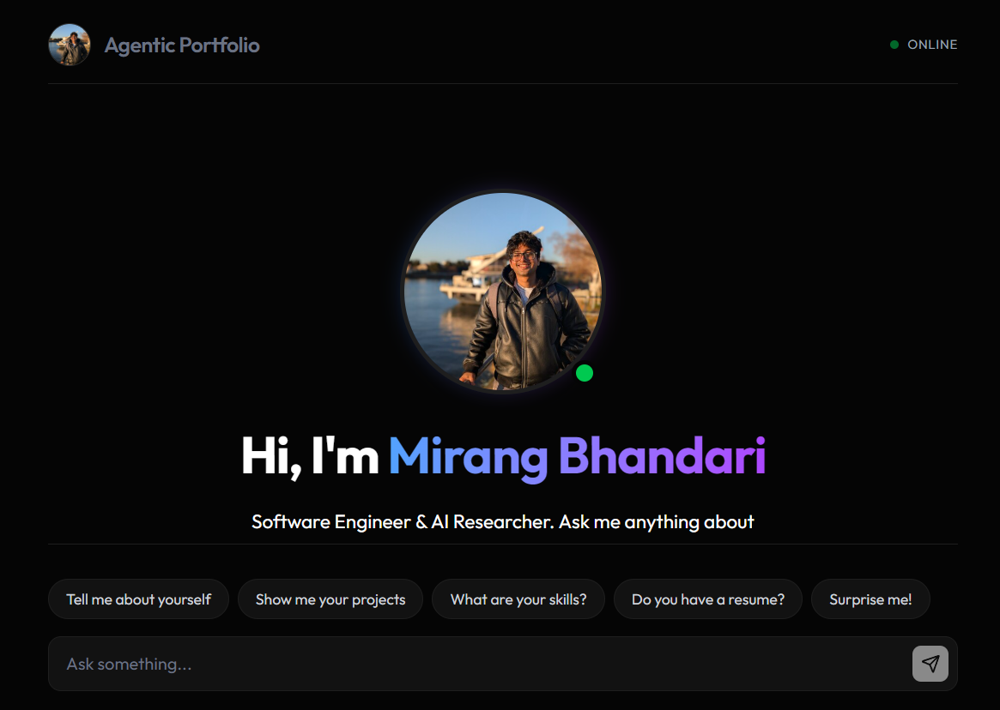

# AgentFolio

Mirang Bhandari's portfolio, presented as a chat app. Visitors ask questions;
common ones are answered instantly from local data with rich widgets
(projects, experience, résumé…), and anything else goes to an LLM (Groq,
`openai/gpt-oss-20b`) through a metered server-side proxy.



React 19 · TypeScript · Vite · Tailwind CSS 4 · Vercel (static site + serverless functions)

## Getting started

```bash
npm install
cp .env.example .env   # then fill in GROQ_API_KEY at minimum
npm run dev
```

`npm run dev` also serves everything in `api/` (see `vite.config.ts`), so the
chat, GitHub widgets and token quota work locally exactly as in production.

| Script | What it does |
| --- | --- |
| `npm run dev` | Dev server with the API routes |
| `npm run build` | Typecheck + production build to `dist/` |
| `npm run lint` | ESLint |
| `npm run resume:sync` | Pull the latest résumé PDF from Google Drive and re-render previews |

## How a message is answered

1. **Commands** — `clear`, `matrix` (`ChatInterface.processCommand`).
2. **Canned answers** — keyword rules in `src/lib/cannedAnswers.ts` return text
   with `{{TAGS}}` such as `{{PROJECTS}}`; `ChatMessage.tsx` swaps each tag for
   its widget. No tokens are spent.
3. **The model** — everything else is streamed from `POST /api/chat`. The
   system prompt is in `src/lib/systemPrompt.ts`; the model can call one tool,
   `fetch_github_activity` (`src/lib/githubTool.ts` → `GET /api/github`).

## Project structure

```
api/                     Vercel serverless functions (each file = one route)
  chat.js                Groq proxy + per-IP token quota (GET = quota, POST = stream)
  github.js              Recent GitHub activity (JSON for the model's tool)
  github-stats.js        GitHub profile numbers for the widget
  github-summary.js      Model-written activity summary, CDN-cached 6h
  _lib/github.js         Shared GitHub fetching (the "_" keeps it from becoming a route)

src/
  App.tsx                Layout shell: sidebar, header, chat, blog overlay
  index.css              Theme tokens (light/dark), keyframes, global styles
  components/
    chat/                The conversation: ChatInterface (state + streaming),
                         ChatMessage (markdown + widget tags), Composer,
                         UsageRing, Thinking indicator, ModelPicker, MatrixEffect
    widgets/             Rich answers rendered inside messages (projects,
                         experience, skills, résumé, GitHub, contact form…)
    blog/                Full-screen blog: list, post reader, section switcher
    layout/              Sidebar
    ui/                  Small generic pieces: Collapse, FadeImg, LogoMark
  lib/                   Non-visual logic, no JSX
    cannedAnswers.ts     Keyword → canned reply rules
    systemPrompt.ts      LLM system prompt;  tone.ts: answer-tone variants
    githubTool.ts        Tool definition + client for the model's GitHub tool
    quota.ts             Token-quota types and formatting
    blogMarkdown.ts      Markdown → blog block parser
    resume.ts            Résumé asset URLs + idle preloading
    theme.ts             Light/dark theme hook with circular reveal
    motion.ts            GSAP setup + motion tier (full / lite / reduced)
    viewTransition.ts    View Transition API wrapper
    dom.ts, hooks.ts     Shared browser helpers and React hooks
  data/
    portfolioData.ts     All portfolio content + its types — edit this to update the site
    blogData.ts          Loads posts from src/content/blog
  content/blog/          Blog posts as Markdown (see its README)
  assets/                Images (any file here can be referenced from blog posts by name)

public/                  Served as-is: favicons, fonts, profile photo
scripts/resume-sync.mjs  Résumé sync script
```

## Common edits

- **Portfolio content** (bio, projects, experience, skills…) → `src/data/portfolioData.ts`
- **Blog post** → add a `.md` file to `src/content/blog/` (guide in that folder's README)
- **Canned answers / keywords** → `src/lib/cannedAnswers.ts`
- **What the model knows / how it talks** → `src/lib/systemPrompt.ts`, `src/lib/tone.ts`
- **Colours** → the tokens at the top of `src/index.css`

## Environment variables

See `.env.example`. On Vercel:

- `GROQ_API_KEY` — server-only; never prefix it with `VITE_` (those are bundled into the browser).
- `KV_REST_API_URL` / `KV_REST_API_TOKEN` — Upstash Redis, set automatically by the Vercel
  Upstash integration. Required for the per-visitor token limit to hold across serverless instances.
- `CHAT_*` — optional quota tuning (limits, window, salt).
- `VITE_GITHUB_TOKEN` — optional, raises the GitHub API rate limit for the `api/github*` routes.
- `VITE_EMAILJS_*` — contact form.
